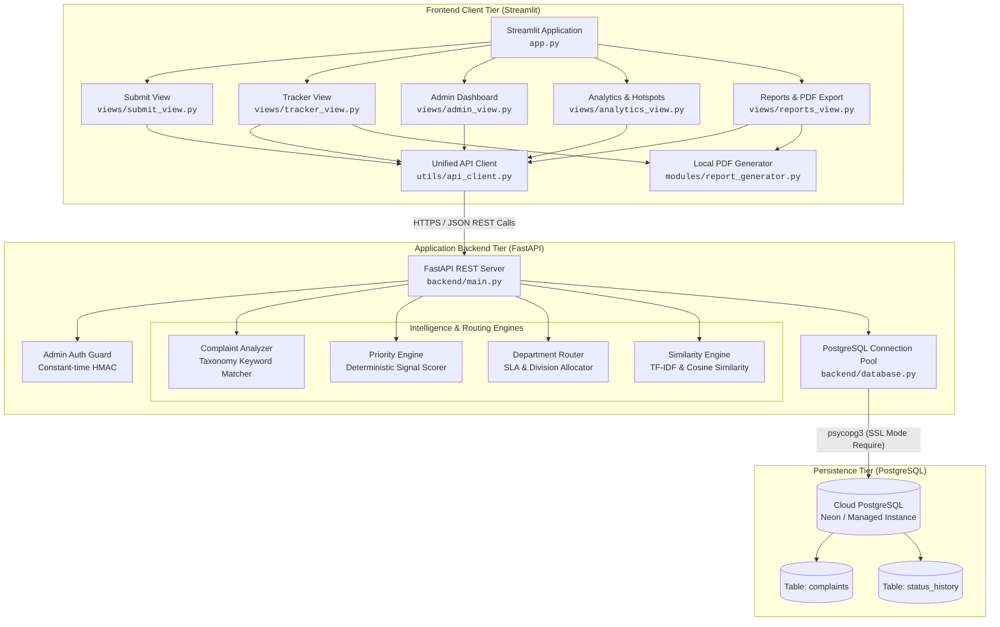
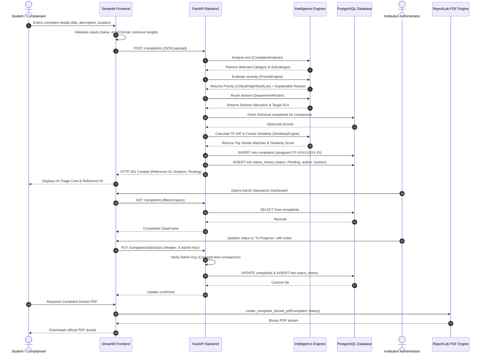
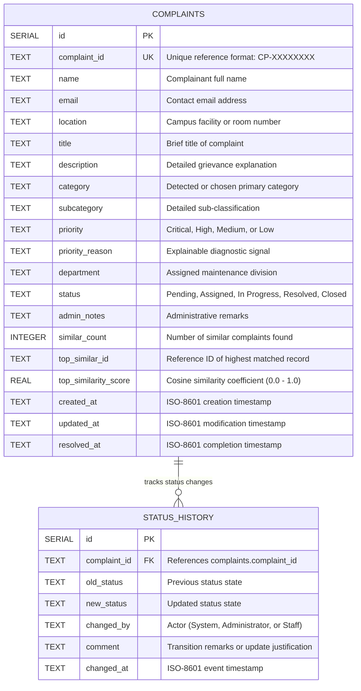

# CivicPulse AI — System Architecture & Technical Specifications

This document outlines the software architecture, component relationships, data flow pipelines, and technical design decisions powering **CivicPulse AI — AI-Powered Institutional Grievance Management and Hotspot Analytics Platform**.

---

## 1. High-Level System Architecture

CivicPulse AI is structured as a decoupled multi-tier web application consisting of a modern **Streamlit frontend client**, an asynchronous **FastAPI REST backend**, a managed cloud **PostgreSQL database (Neon)**, and local **ReportLab document generation engines**.

---

## 2. Component Breakdown

### 2.1. Presentation Tier (Streamlit Frontend)
- **Role:** Delivers an intuitive, responsive user interface accessible across desktop and mobile devices.
- **Key Modules:**
  - `app.py`: Application entry point; initializes configuration, custom typography, session state, and the branded sidebar navigation.
  - `views/submit_view.py`: Multi-section intake form for lodging complaints, validating inputs, and presenting real-time AI triage summaries.
  - `views/tracker_view.py`: Reference ID and email search view with an interactive 5-stage status stepper, status audit history, and on-demand PDF docket export.
  - `views/admin_view.py`: Operations center for administrative triage, multi-column search, filtering, and secure status transitions.
  - `views/analytics_view.py`: Interactive visualization dashboard featuring Plotly charts for department workloads, SLA adherence, and hotspot detection.
  - `views/reports_view.py`: Official governance briefing and executive summary generation module with direct PDF and CSV downloads.
  - `utils/ui_components.py`: Centralized design system with reusable cards, badges, metric tiles, and timeline widgets.
  - `utils/api_client.py`: Resilient HTTP wrapper mediating all communication between frontend views and the FastAPI backend.

### 2.2. Service Tier (FastAPI REST Backend)
- **Role:** Encapsulates business logic, complaint analysis, authentication enforcement, database queries, and status auditing.
- **Key Characteristics:**
  - Built with FastAPI (`backend/main.py`) running via Uvicorn.
  - Comprehensive Pydantic request models (`ComplaintRequest`, `StatusUpdateRequest`) for runtime data validation and email normalization.
  - Administrative endpoints protected by constant-time secret comparison (`X-Admin-Key` / `Bearer` tokens).
  - Production-ready error masking preventing stack traces and sensitive connection parameters from exposing to clients.
  - Health probe endpoint (`/health`) that reports database connectivity, table initialization status, and record counts.

### 2.3. Analytics & NLP Intelligence Tier
- **Rule-Based Complaint Analyzer (`modules/complaint_analyzer.py`):**
  - Uses an institutional taxonomy knowledge graph to classify complaints across 7 key sectors: *Electrical, Water & Plumbing, Network & IT, Cleaning & Sanitation, Infrastructure & Civil, Equipment & Machinery, and General Administration*.
  - Matches multi-word phrase patterns and subcategories to achieve accurate categorization without training overhead.
- **Explainable Priority Engine (`modules/priority_engine.py`):**
  - Scans complaint text for hazard signals across four discrete tiers: `Critical` (e.g. fire hazard, gas leak, electric shock), `High` (e.g. lab blackout, exam session disruption, main pipe burst), `Medium` (default operational issues), and `Low` (cosmetic or minor requests).
  - Returns numerical severity scores alongside human-readable rationale (e.g. *"Immediate Fire / Chemical Safety Hazard"*).
- **Intelligent Department Router (`modules/department_router.py`):**
  - Maps detected categories and subcategories to specific institutional maintenance divisions.
  - Calculates binding Target Service Level Agreements (SLAs) ranging from 4 hours (Security & Emergency) to 48 hours (Civil & Structural).
- **TF-IDF & Cosine Similarity Engine (`modules/similarity_engine.py`):**
  - Implements Scikit-learn's `TfidfVectorizer` to convert cleaned complaint texts into unigram/bigram numerical vector spaces.
  - Computes pairwise cosine similarity against all historical complaints.
  - Flags potential duplicate filings and groups recurring problems that share an operational threshold (default: $\ge 0.35$).

### 2.4. Document Generation Engine (ReportLab)
- **Role:** Generates publication-grade, vector-crisp PDF documents directly from structured data.
- **Key Modules (`modules/report_generator.py`):**
  - `create_complaint_docket_pdf`: Compiles a formal institutional resolution docket for individual complaints, including complete metadata, priority reasons, SLA deadlines, and the chronological audit history.
  - `create_summary_analytics_pdf`: Compiles a comprehensive institutional briefing summarizing total filings, resolution efficiency, department workload breakdown, and identified operational hotspots.

### 2.5. Persistence Tier (PostgreSQL Database)
- **Database Engine:** PostgreSQL (hosted on Neon Serverless PostgreSQL with SSL enforcement).
- **Driver:** `psycopg` (Version 3) using binary pooling (`psycopg_pool`) for high-concurrency connection reuse.
- **Fallback Architecture:** Includes SQLite compatibility modules (`database/database.py`, `database/schema.py`) to support offline local testing.

---

## 3. End-to-End Complaint Processing Workflow

The diagram below details the operational lifecycle of a grievance from initial intake through resolution and executive reporting:

---

## 4. Database Schema Design

The relational database architecture is defined in `database/postgres_schema.sql` and consists of two optimized tables connected logically via `complaint_id`:

### Database Performance Indexes
To guarantee fast query execution during dashboard filtering and high-frequency ticket lookups, the following B-tree indexes are implemented:
- `idx_complaints_complaint_id`: Accelerates exact lookups on ticket reference IDs.
- `idx_complaints_status`: Speeds up admin dashboard filtering by status pipeline.
- `idx_complaints_category`: Accelerates category aggregations and analytics charts.
- `idx_status_history_complaint_id`: Optimizes chronological timeline retrieval for complaint tracking.

---

## 5. Security & Reliability Architecture

| Security Measure | Implementation Mechanism | Purpose |
| :--- | :--- | :--- |
| **Administrative Authentication** | Constant-time HMAC string comparison (`hmac.compare_digest`) via `X-Admin-Key` or `Bearer` tokens. | Protects administrative updates and state transitions against timing attacks and unauthorized tampering. |
| **Fail-Closed Auth Design** | Automatic HTTP 500 rejection if `ADMIN_API_KEY` is undefined or empty. | Prevents endpoints from defaulting to open access in misconfigured environments. |
| **SQL Injection Prevention** | Fully parameterized SQL queries (`%s` placeholders via `psycopg3`). | Eliminates SQL injection vulnerabilities across all dynamic search and update operations. |
| **Input Validation** | Pydantic v2 data models with custom regex validators and normalized email structures. | Rejects malformed, excessive, or unparseable payloads before business processing. |
| **Information Exposure Prevention** | Global FastAPI exception handlers intercept unhandled internal exceptions. | Prevents database stack traces and connection strings from leaking to client responses. |
| **Encrypted Cloud Transport** | SSL mode enforced (`sslmode=require`) on remote database URLs. | Secures data-in-transit between the backend service and cloud PostgreSQL instances. |

---

## 6. Technical Stack Summary

- **Programming Language:** Python 3.10+
- **Frontend Framework:** Streamlit 1.35+
- **Backend Framework:** FastAPI 0.110+ running with Uvicorn ASGI
- **Relational Database:** PostgreSQL (Neon Serverless Cloud)
- **Database Driver:** `psycopg` 3.1+ with `psycopg_pool`
- **Machine Learning / NLP:** `scikit-learn` 1.4+ (TF-IDF Vectorization, Cosine Similarity), NumPy
- **Interactive Visualizations:** Plotly Express & Plotly Graph Objects 5.20+
- **Document Generation:** ReportLab 4.1+
- **Automated Testing:** Pytest 8.0+
